# MicroscopeVuilder — user manual

A puzzle game about building a microscope. You place real optical components on a
bench, and the geometry is traced and the image formed by the same physics a real
instrument obeys: paraxial ray transfer, wavefront aberrations, and partially
coherent image formation. If your build is wrong, it fails for the reason a real
one would.

Fifteen rounds run from a single-lens loupe to differential interference contrast.
Every screenshot below is the program's own output.

---

## 1. Installing

**Download an executable.** Each commit publishes one file per platform under
[Releases](https://github.com/CU-IBIF/MicroscopeWidget/releases): Linux x86-64,
macOS (Intel and Apple silicon) and Windows. No Python, no `pip`, no admin rights.

The binaries are **not code-signed**, so the first launch needs a nudge:

| | |
|---|---|
| macOS | right-click the file → **Open**, then confirm |
| Windows | **More info** → **Run anyway** on the SmartScreen notice |
| Linux | `chmod +x MicroscopeVuilder-linux-x86_64` first |

**Or run from source**, which needs Python 3.11 or 3.12:

```bash
pip install -e ".[ui]"
python -m microscopevuilder --ui
```

On Linux a source install also needs Qt's system libraries (`libegl1`, `libgl1`,
`libxkbcommon0` and the `libxcb-*` set); `.github/workflows/ci.yml` lists the exact
packages.

---

## 2. The workspace

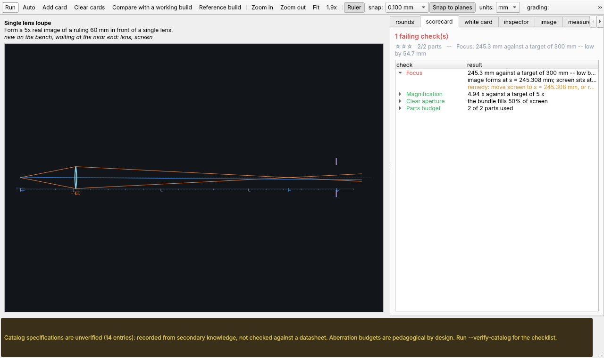

Five things, left to right and top to bottom:

- **The toolbar.** Run and Auto, cards, zoom, the ruler and its snap step, units,
  and the grading policy.
- **The brief**, top left: what this round asks for, and — in italics — what is new
  on the bench and what has been parked.
- **The bench**, the dark panel. The axis runs left to right, light travels that
  way, and every position is quoted as `s` in millimetres from the origin. Blue
  lens shapes, red jaws for stops, filled bars for cards. The orange and blue lines
  are the traced rays; the dashed segments below the axis are the conjugate ribbon,
  and the scale along the bottom is the ruler.
- **The tabs**, right: rounds, scorecard, white card, inspector, image,
  measurements.
- **The amber strip** at the bottom is a standing disclaimer, not an error. The
  objective catalogue was written from secondary knowledge and has not been checked
  against vendor datasheets. Do not quote these numbers against your own bench.

In the figure above, round 1 has just opened. It is **not solved** — the scorecard
says one check is failing, the image forms at 245.3 mm against a target of 300, and
the remedy names the fix. That is the shape of every round.

---

## 3. Playing a round

### The brief, and what is in the tray

A round opens on **the build that solved the previous round**, plus whatever this
round introduces. New components wait at the near end of the axis, bunched together
a few millimetres apart — that is the tray, and the brief names what is in it.
Nothing is ever deleted on your behalf: a component this round has no use for is
**parked** rather than removed (see §7).

### The scorecard

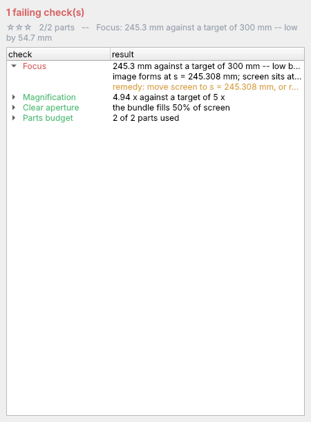

Every rule is a row: what was checked, what your build measured, and what the round
wants. Expand a row for the governing equation with **your** numbers in it, and for
the remedy — a specific instruction, not a hint.

Rules are colour-coded: red is a failure, amber a warning, green a pass. A warning
does not stop you solving a round; it costs a star (§6).

### Placing components

Drag a component along the axis. It can only move along the axis, because that is
the only freedom a bench rail gives you.

Three aids, because a pixel of drag is worth about half a millimetre and some
tolerances are a fifth of that:

- **Zoom** — the mouse wheel, or `Zoom in` / `Zoom out` / `Fit`. The toolbar shows
  the current scale.
- **The ruler and snapping** — `snap:` sets the step (0.1 mm by default, with
  imperial steps available under `units:`). `Snap to planes` additionally snaps to
  the image, pupil and focal planes the round is actually about. Hold **Alt** while
  dragging to suspend snapping.
- **Typed positions** — the inspector takes a number directly.

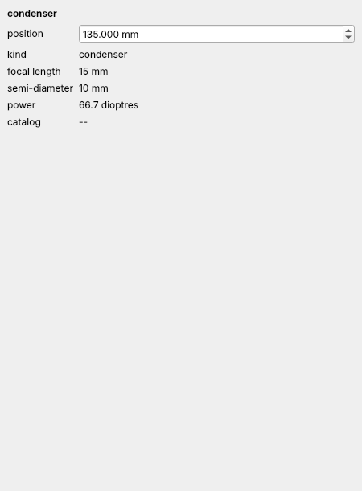

Select a component and the inspector gives its position as an editable field, plus
its kind, focal length, semi-diameter, optical power and catalogue entry.

### Grading policy

`grading:` switches between **strict** and **forgiving**. Strict grades against the
derived physical tolerance — depth of focus, pupil conjugate tolerance. Forgiving
allows 5% of the target distance, which is the setting to use if you are playing
with a trackpad. The scorecard always states both the tolerance applied and the
physical one, so you can see what you were let off.

---

## 4. Testing what you built

Geometry is checked continuously, on every drag. Forming the **image** costs real
computation, so it happens on demand.

- **Run** forms the image now.
- **Auto** re-images whenever the build changes, debounced so a drag reacts to
  where you put the component down rather than to every pixel on the way.

Either way, only what actually changed is recomputed. Moving a card re-renders that
one pane and leaves the ray trace alone; moving a lens invalidates everything;
changing the specimen or wavelength re-images without re-tracing. A run with
nothing changed does no work and says so.

### The image tab

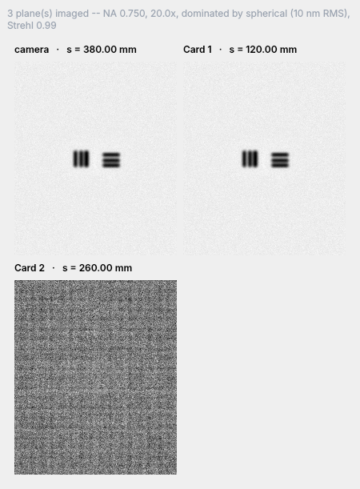

The detector gets a pane, and so does every white card, numbered 1…n along the axis
and carrying the same number on the bench. The caption gives each plane's position.

The figure above is the point of the whole feature: the camera plane and Card 1 both
show the resolution target sharply, while Card 2 at 260 mm shows nothing but noise —
it is nowhere near an image plane. A progress bar counts the planes as they render,
and a pane with no image at its plane says why rather than going blank.

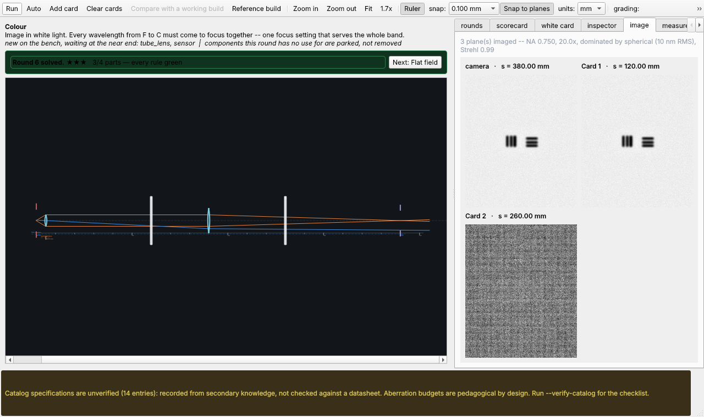

### Measurements

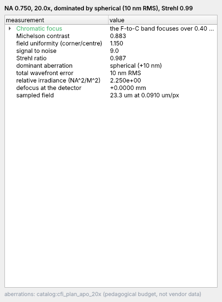

What the rendered image measures: Michelson contrast, field uniformity, signal to
noise, Strehl ratio, the dominant aberration and total wavefront error, relative
irradiance, defocus at the detector, and the sampled field in µm per pixel. Rounds
6, 7, 8, 13, 14 and 15 are graded on these, which is why they cannot be passed
without pressing Run (§6).

---

## 5. The white card

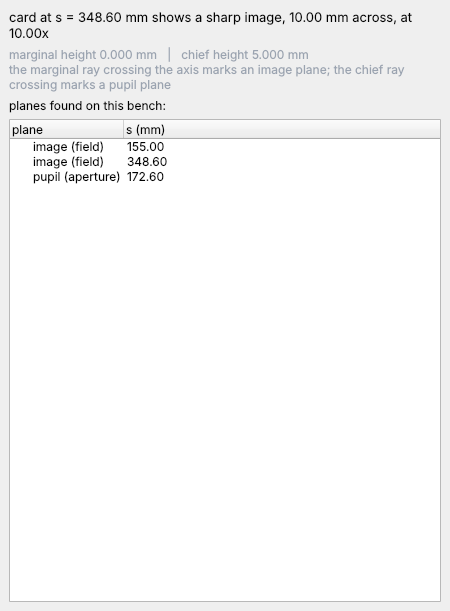

`Add card` drops a white card on the axis; drag it anywhere, including places where
no image forms. The card reports what is physically there:

> card at s = 348.60 mm shows a sharp image, 10.00 mm across, at 10.00x
> marginal height 0.000 mm | chief height 5.000 mm

The two ray heights are the instrument. **The marginal ray crossing the axis marks
an image plane; the chief ray crossing marks a pupil plane.** Below that, the panel
lists every plane it found on the bench with its position — which is how you locate
the back focal plane for a phase ring, or check that your field diaphragm really is
conjugate to the specimen.

A card placed upstream of the specimen says so instead of inventing a reading.
`Clear cards` removes them all. Cards are probes, not parts: they never count
against the budget.

---

## 6. Scoring

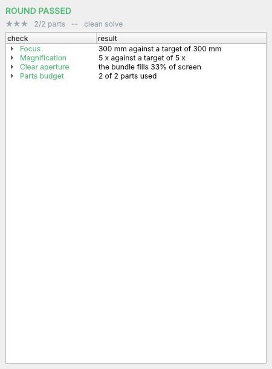

Three stars:

| star | earned by |
|---|---|
| ★ | solving the round at all — every applicable rule green |
| ★ | no warnings outstanding |
| ★ | staying inside the parts budget |

The parts budget is what stops "add another lens" being the answer to everything;
it counts everything in the light path except cards, stops and the lamp. A parked
component is not charged for.

**A round graded on a rendered image cannot be passed on ray geometry alone.** Until
you press Run, such a round reads *provisional*: the scorecard says the geometry is
green and the verdict is withheld. This is not a formality — it is the half of the
round that teaches resolution, sampling, field flatness and chromatic focus.

Stuck? **Compare with a working build** lists how your bench differs from one that
solves the round — missing, extra, moved, or differing in specification. It tells
you *what* differs, deliberately not *why it matters*. Working that out is the round.

### Solving one


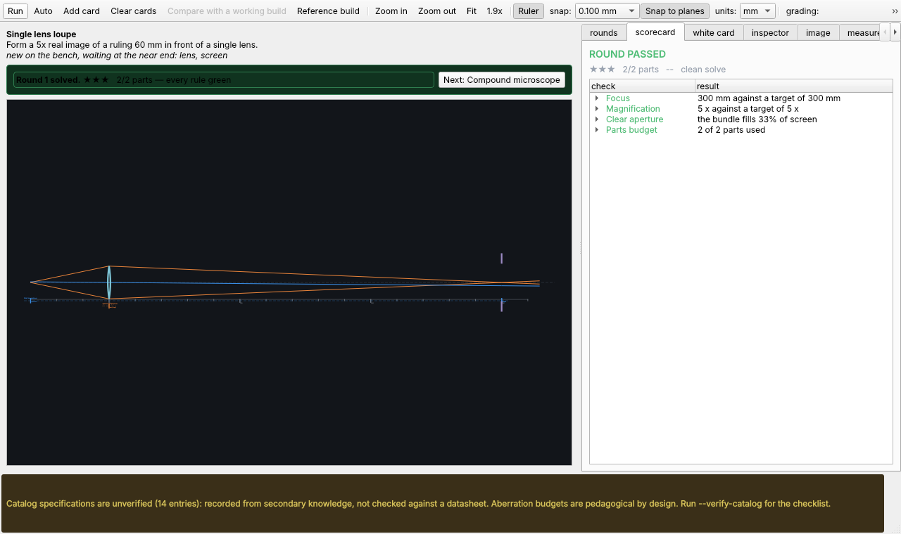

A solved round is a moment, not a state the app notices quietly: the banner states
the rating and offers the way on. Your build is saved with the rating it earned,
and the next round starts from it.

---

## 7. Progression

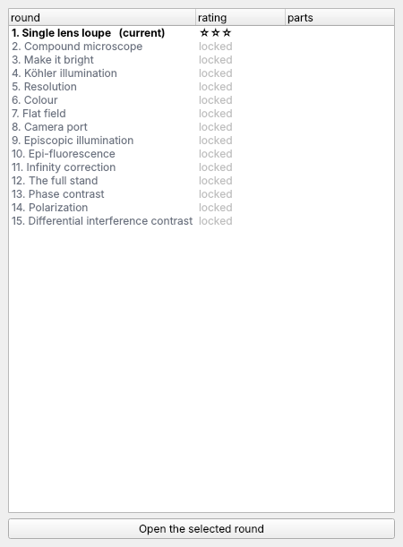

The **rounds** tab is the hub. Each row gives a round, its rating and its best parts
count; a locked row says what it is waiting for. Double-click, or use *Open the
selected round*.

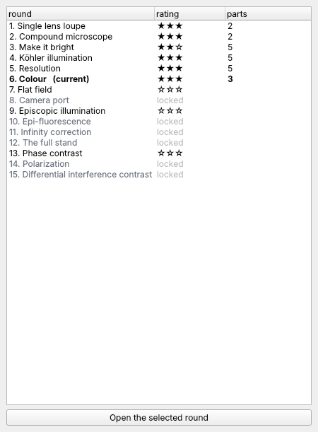

Progression is not a straight line. Rounds 1–4 teach, 5–8 tighten the tolerances,
9–12 restructure the bench and 13–15 are the contrast techniques — but the
episcopic rounds branch off round 5 and the contrast techniques off Köhler, because
a phase ring is unteachable to someone who does not yet own the back focal plane.
In the figure above, rounds 9 and 13 are open while 8 is still locked.

**Your bench carries forward.** Round *N* opens on the build you solved round *N−1*
with, at the positions you chose. One instrument grows across fifteen rounds, and a
build that passed while sloppy stays sloppy until you fix it.

- **Nothing is removed for you.** A component this round has no use for is parked —
  still on the bench, still yours, costing no light and nothing to align, and not
  charged against the budget.
- **A better part is never installed for you.** Round 5 wants more numerical
  aperture than round 4 needed; its rules say so, and fitting it is the round.
- **The specimen always comes from the round.** It is what you are given to look at,
  not a component you own.
- **Replaying is free.** More stars wins; on equal stars, fewer parts wins. A worse
  attempt never spoils a record, and the saved build travels with the rating that
  earned it.

### Where your progress lives

In the per-user config directory — `~/.config/MicroscopeVuilder/progress.json` on
Linux, `~/Library/Application Support/MicroscopeVuilder` on macOS,
`%LOCALAPPDATA%\MicroscopeVuilder` on Windows — never beside the executable, so a
binary on a read-only share still works and two people on one machine do not
overwrite each other. It holds your rating, best parts count and solving build per
round, plus the round you were last on; the game reopens there.

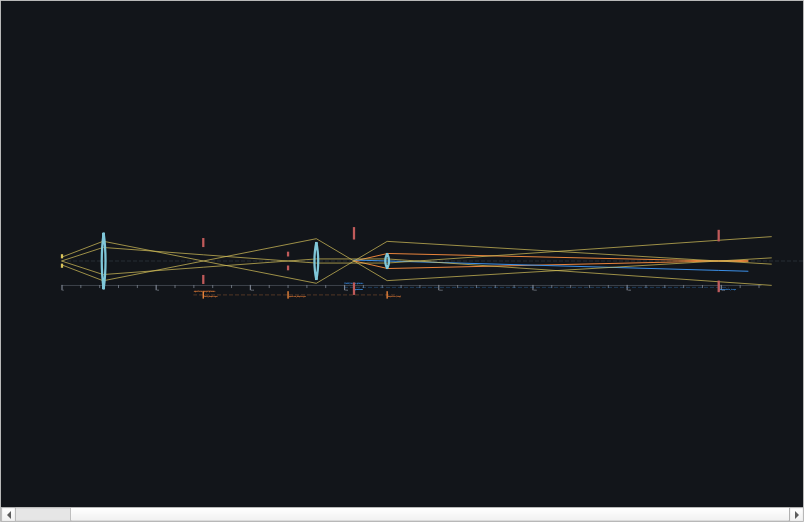

---

## 8. The rounds

| # | Round | Introduces |
|---|---|---|
| 1 | Single lens loupe | Conjugates, `1/f = 1/s + 1/s'` |
| 2 | Compound microscope | Objective and eyepiece, optical tube length |
| 3 | Make it bright | Critical illumination, collected NA |
| 4 | Köhler illumination | Field and aperture diaphragms, four-plane conjugacy |
| 5 | Resolution | NA, the Abbe limit, condenser matching |
| 6 | Colour | Secondary spectrum, achromat against apochromat |
| 7 | Flat field | Field curvature, plan objectives |
| 8 | Camera port | Nyquist sampling, empty magnification |
| 9 | Episcopic illumination | Vertical illuminator, the objective as its own condenser |
| 10 | Epi-fluorescence | Dichroics, Stokes shift, bleedthrough |
| 11 | Infinity correction | Infinity space, the tube lens |
| 12 | The full stand | Turret parfocality |
| 13 | Phase contrast | Annulus and ring, conjugate to the back focal plane |
| 14 | Polarization | Jones calculus, crossed polars |
| 15 | Differential interference contrast | Wollaston shear, bias retardation |

A sandbox is always available, from the start and with no prerequisite. It grades
nothing and reports everything — the place to try an idea without a win condition.

---

## 9. Command line

The game also runs headless, which is how the rounds are tested:

```bash
python -m microscopevuilder --list              # rounds, with lock state
python -m microscopevuilder --round 7           # grade the reference build
python -m microscopevuilder --round 7 --diff    # and compare against a working one
python -m microscopevuilder --bench mine.json --round 7
python -m microscopevuilder --ui                # the workspace, resuming where you left off
```

Benches are plain JSON, so a build can be shared as a file. `--no-measure` skips the
rendered-image rules; a round graded on them then reports **not graded** rather than
a pass. Exit codes: `0` passed, `1` failed, `2` not graded.

`--strict` grades positions at the physical tolerance regardless of the policy,
`--progress` points at a different save file, `--verify-catalog` prints which
catalogue entries still need a datasheet check, and `--save-reference` writes a
round's reference build out as JSON.

---

## 10. If something looks wrong

**A round opens with components bunched at the left.** That is the tray — the
round's new parts, waiting to be positioned. Intended.

**The scorecard says the geometry is green but nothing passes.** The round is graded
on a rendered image. Press Run.

**The image pane says there is no image at this plane.** There isn't one. Move the
card, or use the white card's plane list to find where the planes actually are.

**A locked round will not open.** The hub names its prerequisite.

**The catalogue numbers do not match my objective.** They are pedagogical, written
from secondary knowledge and not checked against datasheets; the amber strip says
so. `--verify-catalog` prints the checklist of what would need confirming.

---

## 11. If your antivirus flags the download

This is expected, and it is worth understanding rather than just clicking through.

**Why it happens.** A one-file PyInstaller executable carries a compressed archive
of Python, Qt and the program, and unpacks it to a temporary directory at startup.
That is structurally what a self-extracting packer does, and packers are what
malware uses to hide its payload. Heuristic and machine-learning engines score on
that shape, so unsigned one-file Python builds get flagged routinely — typically
under a generic, ML-suffixed name such as `Trojan:Win32/Wacatac.B!ml` or
`Program:Win32/Wacapew.C!ml`, rather than a specific family. Three things make it
more likely here: the binary is **unsigned**, each build is a **brand-new file**
almost nobody has downloaded, and reputation systems treat unknown files as
suspect by default.

**What you can check, in increasing order of strength.**

1. **Verify the download.** Each release publishes `SHA256SUMS`. If your copy
   matches, the file is what the build produced and was not altered in transit:

   ```sh
   sha256sum -c SHA256SUMS --ignore-missing      # Linux
   shasum -a 256 -c SHA256SUMS --ignore-missing  # macOS
   ```
   ```powershell
   Get-FileHash .\MicroscopeVuilder-windows-x86_64.exe -Algorithm SHA256
   ```

2. **Read the build.** Releases are built by GitHub Actions from this repository,
   and the run is public: the log shows the commit, the dependency set and every
   command. Nothing is downloaded at build time except packages from PyPI.

3. **Get a second opinion.** Upload the file to
   [VirusTotal](https://www.virustotal.com/), which runs it past some seventy
   engines. The expected result for a build like this is a handful of heuristic
   detections against a large majority of clean verdicts, with no agreement on a
   family. A specific, named, widely-agreed detection would be a different matter
   — if you see that, please open an issue and do not run the file.

4. **Skip the binary entirely.** Running from source involves no frozen executable
   and nothing to flag:

   ```sh
   pip install -e ".[ui]"
   python -m microscopevuilder --ui
   ```

**What would actually fix it:** code-signing the Windows and macOS builds with a
certificate, plus notarization on macOS. That is a cost decision rather than a
technical one — an EV certificate is the thing that buys SmartScreen reputation —
and it is recorded as an open item in `docs/PLAN.md`.

**Reporting the false positive** helps everyone downloading it after you. Microsoft
take submissions at
<https://www.microsoft.com/en-us/wdsi/filesubmission>; most vendors have an
equivalent form.
